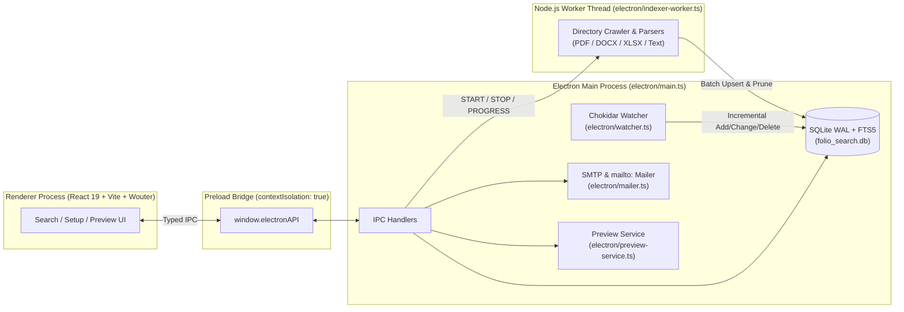

# Folio — Network Drive Search & Discovery

**Folio** is a native desktop document search and discovery application built with **Electron**, **React 19**, and an embedded **SQLite FTS5** search engine.

It crawls and indexes mapped network drives, Windows UNC shares (`\\Server\Share\Folder`), or local directories inside a background Node.js Worker Thread so teams can search, preview, share, and email documents in milliseconds—without any data leaving the local machine.

---

## Key Features

### 1. Guided 3-Step Setup & Network Validation
- **Target Selection & Ping**: Browse natively via the OS folder picker or enter a mapped drive (`Z:\Documents`) or UNC path (`\\FileServer\SharedDocs`). Includes a timeout-guarded (3.5s) connectivity test that reports read access, network latency (`ms`), and top-level file count.
- **Granular Indexing Rules**: Toggle supported file extensions, configure wildcard exclusion patterns (automatically ignoring Office lock files like `~$*`, `*.tmp`, dotfiles, `.git`, and `node_modules`), set a maximum file size threshold (10 MB – 100 MB), and toggle real-time file watching.
- **Live Worker Crawl Telemetry**: Watch real-time progress with a `files/sec` velocity badge, `Scanned` / `Indexed (FTS5)` / `Skipped` counters, and an expandable live activity log drawer that records locked or oversized files.

### 2. Instant Full-Text Search (SQLite FTS5) & Faceted Filtering
- **Dual Search Modes**:
  - **Full Content (`FTS5`)**: Uses SQLite's `FTS5` virtual table with the `porter unicode61` stemmer tokenizer, `bm25()` relevance ranking, and `snippet()` extraction with `<mark>` keyword highlighting.
  - **Filename Only (`LIKE`)**: Fast substring matching on document filenames ordered by modification timestamp.
- **Debounced Input**: 200ms debounced search input with live query execution timing (`ms`).
- **Quick Filters Drawer**: Filter results by file extension (populated with live document counts per extension), modified-after / modified-before dates, and minimum / maximum file size in MB.

### 3. Resizable Split-Pane Workspace & Inline Previews
- **Draggable Split Pane**: Resize the search results list and document preview pane smoothly (`30%` to `75%`).
- **Format-Specific Inline Viewers**:
  - **PDF (`.pdf`)**: Embedded base64 PDF viewer (`<iframe>`) with native zoom/page controls.
  - **Word (`.docx`)**: Converted to clean semantic HTML via `mammoth` and sanitized with `sanitize-html`.
  - **Spreadsheets (`.xlsx`, `.xls`, `.xlsm`, `.ods`, `.csv`, `.tsv`)**: Extracted sheet-by-sheet and row-by-row using an in-memory `zlib` XML/ZIP reader and rendered in a searchable tabular text view.
  - **Plaintext, Markdown, Logs & JSON (`.txt`, `.md`, `.log`, `.json`)**: Monospace viewer with an interactive **"Find in Preview"** toolbar (`X of Y` match counter and next/previous match navigation).
- **Network Drop Protection**: All file previews are wrapped in a 4-second timeout guard with a one-click retry state if a network share disconnects.
- **Full-Page Reader**: Dedicated `/view/:id` route for distraction-free document reading.

### 4. Network Path Sharing, OS Integration & Email Dispatch
- **One-Click Clipboard Links**:
  - **UNC Path**: Normalized Windows network path (`\\Server\Share\subfolder\document.pdf`).
  - **`file://` URL**: Standard RFC-compliant file URI (`file:///...`).
  - **Markdown Link**: Ready-to-paste Markdown reference (`[document.pdf](\\Server\Share\subfolder\document.pdf)`).
- **Native Folder Reveal**: **Show in Folder** button wired to Electron's `shell.showItemInFolder()` to highlight the file directly in macOS Finder or Windows Explorer.
- **Email Dispatcher with 25 MB Safeguard**:
  - Choose between sending the **File Attachment** or an **Internal UNC Link**.
  - **25 MB Attachment Safeguard**: Automatically warns and blocks attachments larger than 25 MB in both the UI and backend, prompting the user to switch to **Internal UNC Link** mode.
  - **Dual Delivery**: Launch the system's default mail client (`mailto:`) or send directly via built-in/custom **SMTP** (`nodemailer`).

---

## Supported File Formats

| Category | Extensions | Indexing Method | Inline Preview |
| :--- | :--- | :--- | :--- |
| **PDF Documents** | `.pdf` | `pdf-parse` full-text extraction | Embedded PDF `<iframe>` |
| **Word Documents** | `.docx` | `mammoth.extractRawText()` | Sanitized HTML (`mammoth` + `sanitize-html`) |
| **Spreadsheets** | `.xlsx`, `.xlsm`, `.ods`, `.xls`, `.csv`, `.tsv` | Built-in `zlib` ZIP/XML worksheet & shared-string parser + UTF-8/ASCII extractor | Sheet-by-sheet tabular text + Find in Preview |
| **Text, Docs & Data** | `.txt`, `.md`, `.json`, `.log` | UTF-8 stream reader (up to 2M chars) | Monospace text + Find in Preview |

---

## System Architecture



### Database Schema (`electron/database.ts`)
- **`config`**: Stores the single active configuration row (`root_path`, `include_extensions`, `exclude_patterns`, `max_file_size_bytes`, `indexing_frequency`, `background_sync`, `last_indexed_at`, `indexed_count`).
- **`files`**: Stores file metadata (`id`, `path`, `relative_path`, `filename`, `extension`, `size`, `mtime`, `mime_type`, `indexed_at`) and extracted `content`.
- **`files_fts`**: External-content `FTS5` virtual table (`content='files'`, `tokenize='porter unicode61'`) kept automatically in sync via `AFTER INSERT`, `AFTER UPDATE`, and `AFTER DELETE` triggers (`files_ai`, `files_au`, `files_ad`).
- **Storage Location**:
  - Inside Electron: `<app.getPath('userData')>/folio_search.db`
  - Standalone scripts/tests: `./.folio_data/folio_search.db`

---

## Project Structure

```text
ttps-file-directory/
├── electron/
│   ├── main.ts                # Electron app lifecycle, BrowserWindow, CSP, and IPC handlers
│   ├── preload.ts             # Context-isolated bridge exposing window.electronAPI
│   ├── types.ts               # Shared TypeScript interfaces for IPC, config, search, and previews
│   ├── database.ts            # SQLite WAL setup, FTS5 virtual table, triggers, and BM25 queries
│   ├── indexer-worker.ts      # Background Worker Thread crawler, text extractor, and batch indexer
│   ├── spreadsheet-parser.ts  # Zero-dependency .xlsx/.xlsm/.ods/.xls/.csv/.tsv text parser
│   ├── watcher.ts             # Chokidar real-time file watcher for incremental index sync
│   ├── preview-service.ts     # Timeout-guarded PDF, DOCX, Spreadsheet, and text preview generator
│   ├── network-utils.ts       # UNC path normalization, file:// URLs, Markdown links, and target ping
│   └── mailer.ts              # Native mailto: builder and Nodemailer SMTP dispatcher (25 MB guard)
├── artifacts/
│   └── document-discovery/    # React 19 + Vite + Tailwind CSS v4 frontend
│       ├── index.html
│       ├── vite.config.ts
│       └── src/
│           ├── App.tsx        # Search workspace, 3-step setup wizard, preview pane, settings, email modal
│           ├── index.css      # Blue light/dark theme tokens and component styles
│           └── lib/
│               └── electron-client.ts # Renderer IPC client + browser preview fallback mock
├── sample-data/               # Sample PDF, DOCX, XLSX, CSV, Markdown, JSON, TXT, and LOG documents
├── scripts/
│   ├── build-electron.mjs     # esbuild bundler for main.js, preload.js, and indexer-worker.js
│   ├── test-desktop-pipeline.mjs # End-to-end test for SQLite FTS5, parsers, UNC paths, and safeguards
│   └── test-indexer-worker.mjs   # End-to-end test for the background Worker Thread crawler
└── package.json
```

---

## Getting Started

### Prerequisites
- **Node.js** 20+ (or 22/24)
- **npm** or **pnpm**

### Build & Launch the Desktop App

1. **Build the UI and Electron bundles**:
   ```bash
   npm run build
   ```
   This compiles the React frontend into `artifacts/document-discovery/dist/public` and bundles the Electron main process, preload script, and background worker into `dist-electron/`.

2. **Launch the Electron desktop application**:
   ```bash
   npm run electron
   ```
   *(Or run `npm run dev` to rebuild `dist-electron/` and launch Electron in one command.)*

### Available Scripts

| Command | Description |
| :--- | :--- |
| `npm run build` | Builds both the React UI (`build:ui`) and Electron TypeScript files (`build:electron`). |
| `npm run electron` | Launches the native Electron desktop application (`npx electron .`). |
| `npm run dev` | Rebuilds the Electron scripts and launches the Electron app. |
| `npm run dev:ui` | Starts the Vite dev server (`http://localhost:5173`) for standalone UI development. |
| `npm test` | Builds Electron and runs both automated verification suites (`test-desktop-pipeline.mjs` & `test-indexer-worker.mjs`). |
| `npm run typecheck` | Runs TypeScript typechecking across workspace packages, the React UI, and all `electron/*.ts` files. |

---

## Optional SMTP Configuration

Users can either open emails in their default desktop mail client (**Open in Mail App** via `mailto:`) or send directly via **SMTP**. SMTP credentials can be entered directly in the **Email File → Configure custom SMTP server** accordion in the UI, or supplied via environment variables:

```bash
SMTP_HOST=smtp.example.com
SMTP_PORT=587
SMTP_SECURE=false
SMTP_USER=user@example.com
SMTP_PASS=your_password
SMTP_FROM=Folio Discovery <user@example.com>
```

---

## Testing & Verification

Run the automated test suite at any time with:

```bash
npm test
```

This executes two verification suites:
1. **`scripts/test-desktop-pipeline.mjs`**:
   - Verifies SQLite WAL mode, `files` schema, `files_fts` virtual table, and `porter unicode61` triggers.
   - Tests PDF (`pdf-parse`), DOCX (`mammoth`), and Markdown text & HTML extraction on `./sample-data`.
   - Verifies `FTS5` `MATCH` queries with `<mark>` snippet highlighting and `LIKE` filename queries.
   - Verifies Windows UNC path normalization (`\\FileServer01\SharedDocs\...`) and Markdown link generation.
   - Verifies the 25 MB email attachment safeguard.
2. **`scripts/test-indexer-worker.mjs`**:
   - Spawns `dist-electron/indexer-worker.js` in a real Node.js `Worker` thread against `./sample-data`.
   - Verifies `PROGRESS` telemetry (`scanning` → `indexing` → `complete`), row counts across `files` and `files_fts` (including `.xlsx` spreadsheets), and FTS search accuracy.

